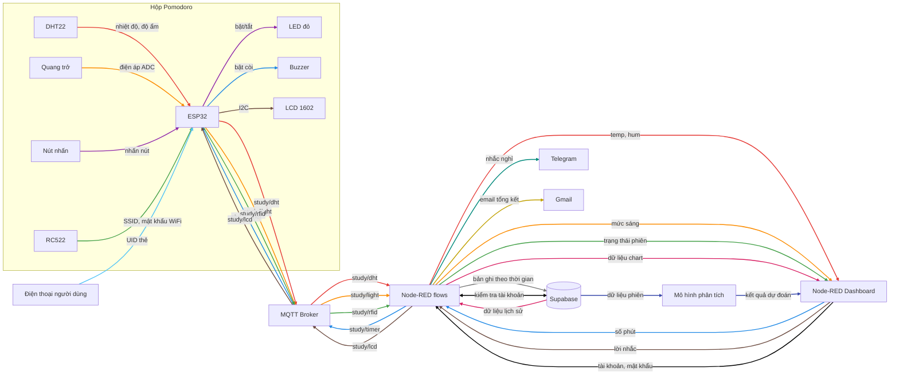

# THUYẾT MINH DỰ ÁN (BẢN NHÁP): TRẠM HỌC TẬP POMODORO

> Bản nháp để nhóm thống nhất hướng đi. Chỗ có `[...]` là phần nhóm cần điền hoặc quyết định.
> Bản nộp cuối là file PDF, đặt tên `MANHOM_MSSV1_MSSV2_MSSV3_PROPOSAL.PDF`.

---

## 0. Ghi chú cho nhóm (xóa phần này khi xuất PDF)

### 0.1. Định dạng bắt buộc

- File PDF, tên `MANHOM_MSSV1_MSSV2_MSSV3_PROPOSAL.PDF`.
- Font Times New Roman, cỡ 13, giãn dòng 1.15, canh đều hai bên.
- Hình ảnh và chữ trong hình phải đọc được khi in ra.
- Ai cũng phải hiểu toàn bộ nội dung báo cáo, không chỉ phần của mình.

### 0.2. Những điểm quan trọng từ yêu cầu

- Các chức năng trong thuyết minh là căn cứ chấm điểm cuối kỳ. Cuối kỳ chỉ được đổi tối đa **một** chức năng. Vì vậy cần chọn chức năng chắc chắn làm được.
- Mỗi chức năng chỉ giao cho **một** thành viên.
- Mọi thiết bị input/output giữa các yêu cầu (căn bản và nâng cao) phải đôi một khác nhau.
- Mỗi yêu cầu nâng cao (YC1 đến YC12) chỉ được làm một lần trong nhóm.
- Điểm nâng cao tối đa là 4. Bản nháp này đăng ký khoảng 5 điểm cho mỗi người để có dự phòng nếu một chức năng không xong.

### 0.3. Thay đổi so với proposal cũ (26/10)

- Web chuyển sang **Node-RED** (flows + Node-RED Dashboard). Vì vậy bỏ YC10 (tự xây dựng website, 2.0 điểm).
- Để bù cho Hào, thay YC10 bằng **YC12: cấu hình WiFi bằng web server tự xây dựng trên ESP32** (2.0 điểm).
- Repo hiện tại (README, CLAUDE.md, thư mục `backend/`, `frontend/`) vẫn ghi "không dùng Node-RED". Nhóm cần cập nhật lại repo cho khớp.
- Các mục trong proposal cũ như nguyên lý vật lý, sơ đồ nối chân, danh sách topic MQTT không có trong mẫu thuyết minh. Có thể đưa vào phụ lục hoặc để dành cho báo cáo cuối kỳ.

### 0.4. Cần nhóm quyết định

- [ ] Mã nhóm (STT trên link đăng ký nhóm), MSSV từng người.
- [ ] MQTT broker: HiveMQ Cloud (miễn phí, chạy qua Internet) hay Mosquitto chạy chung máy với Node-RED.
- [ ] Node-RED chạy ở đâu: laptop một thành viên hay máy chủ cloud (ví dụ FlowFuse).
- [ ] Cách Node-RED kết nối Supabase: gọi REST API của Supabase bằng node `http request`, hay kết nối thẳng PostgreSQL bằng node `postgresql`.
- [x] Lịch học kỳ: HK1 kết thúc 19/12/2026 (tuần T12). Thời gian làm sản phẩm là T6 đến T12 (02/11 đến 20/12/2026).
- [ ] Có giữ đăng ký khoảng 5 điểm nâng cao mỗi người không, hay bỏ bớt cho nhẹ việc.

---

## Trang bìa

- Trường: [Tên trường]
- Khoa: [Tên khoa]
- Môn học: Vật lý cho Công nghệ thông tin, HK1/2026-2027
- Tên đề tài: **Trạm học tập Pomodoro (Pomodoro Box)**
- Mã số nhóm: [STT nhóm]

| STT | Họ tên | MSSV |
|---|---|---|
| 1 | Nguyễn Trần Tuấn Minh | [MSSV] |
| 2 | Nguyễn Quốc Dương | [MSSV] |
| 3 | La Anh Hào | [MSSV] |

---

## 1. Giới thiệu

### 1.1. Tổng quan sản phẩm

Pomodoro là phương pháp học chia thời gian thành phiên tập trung ngắn (thường 25 phút), xen kẽ với lần nghỉ ngắn (5 phút). Khi tự áp dụng, sinh viên hay gặp các vấn đề: dùng điện thoại để bấm giờ rồi bị cuốn vào mạng xã hội, bỏ qua giờ nghỉ, không biết mình đã học bao nhiêu phiên, không để ý góc học quá nóng hoặc thiếu sáng, và người xung quanh không biết mình đang tập trung.

**Trạm học tập Pomodoro** là một hộp nhỏ đặt trên bàn học. Bên trong có board ESP32 kết nối với hệ thống quản lý trên Node-RED qua giao thức MQTT. Người dùng quẹt thẻ để bắt đầu phiên học, đặt thời gian trên web, hết giờ thì còi báo. Hộp có đèn đỏ báo "đang tập trung", màn hình LCD hiện lời nhắc, và các cảm biến theo dõi nhiệt độ, độ ẩm, ánh sáng. Dữ liệu được lưu lên cloud để vẽ biểu đồ và phân tích điều kiện học hiệu quả nhất.

### 1.2. Ý nghĩa thực tế

- Giúp sinh viên học đúng nhịp Pomodoro mà không cần cầm điện thoại.
- Nhắc nghỉ đúng lúc để giảm mỏi mắt và mệt mỏi.
- Ghi lại số phiên học, giúp người dùng tự đánh giá thói quen học.
- Cảnh báo khi góc học không phù hợp (quá nóng, thiếu sáng).
- Báo cho người xung quanh biết đang tập trung để hạn chế bị làm phiền.

### 1.3. Danh sách chức năng

| ID | Thông tin chức năng căn bản | Mô tả luồng xử lý |
|---|---|---|
| 1 | Cảm biến DHT22 (Input) | DHT22 → ESP32 → MQTT (`study/dht`) → Node-RED → Dashboard: hiển thị nhiệt độ, độ ẩm của góc học theo thời gian thực. |
| 2 | Module quang trở LM393 (Input) | Quang trở → ESP32 (đọc ADC) → MQTT (`study/light`) → Node-RED → Dashboard: hiển thị mức sáng và báo đủ sáng hay thiếu sáng để học. |
| 3 | Buzzer chủ động (Output) | Dashboard (nhập số phút) → Node-RED → MQTT (`study/timer`) → ESP32 đếm giờ → Buzzer kêu khi hết phiên, báo chuyển sang nghỉ. |

| ID | Thông tin chức năng nâng cao | Mô tả luồng xử lý |
|---|---|---|
| 4 | **YC1.** Nút nhấn (Input), LED đỏ (Output) | Nhấn nút → ESP32 → bật/tắt LED đỏ báo "đang tập trung". Xử lý ngay trên ESP32, không qua web. |
| 5 | **YC2.** Đầu đọc RFID RC522 (Input) | Quẹt thẻ → ESP32 đọc UID → MQTT (`study/rfid`) → Node-RED → Dashboard: bắt đầu hoặc kết thúc phiên học, hiển thị trạng thái phiên. |
| 6 | **YC3.** Màn hình LCD 1602 I2C (Output) | Dashboard (gõ lời nhắc) → Node-RED → MQTT (`study/lcd`) → ESP32 → LCD dòng 1 hiển thị lời nhắc hoặc mục tiêu phiên học, dòng 2 hiển thị trạng thái và thời gian còn lại của phiên. |
| 7 | **YC4.** Supabase (PostgreSQL) | Node-RED lưu dữ liệu nhiệt độ, độ ẩm, ánh sáng và lịch sử phiên học **theo thời gian** vào các bảng trên Supabase. |
| 8 | **YC5.** Supabase + biểu đồ Node-RED Dashboard | Node-RED đọc dữ liệu lịch sử từ Supabase → hiển thị **dạng chart** (nhiệt độ, độ ẩm, ánh sáng theo thời gian, số phiên mỗi ngày). |
| 9 | **YC6.** Telegram Bot | Khi một phiên học kéo dài quá [90] phút mà chưa quẹt thẻ kết thúc, Node-RED gửi tin nhắn Telegram nhắc người dùng nghỉ. |
| 10 | **YC7.** Gmail (SMTP) | Cuối mỗi tuần, Node-RED tổng hợp số phiên Pomodoro đã hoàn thành và gửi email tổng kết cho người dùng. |
| 11 | **YC9.** Supabase (PostgreSQL) | Đăng ký, đăng nhập trên Dashboard. Tài khoản (mật khẩu đã mã hóa) lưu trong database Supabase. Chưa đăng nhập thì không xem và điều khiển được hệ thống. |
| 12 | **YC11.** Tự xây dựng | Mô hình tự xây dựng (ví dụ cây quyết định hoặc hồi quy logistic) dùng dữ liệu phiên học (giờ học, nhiệt độ, độ ẩm, ánh sáng) để dự đoán khả năng hoàn thành phiên và gợi ý khung giờ, điều kiện học tốt nhất. Kết quả hiển thị trên Dashboard. |
| 13 | **YC12.** Tự xây dựng web server | Khi chưa có WiFi hoặc đổi chỗ, ESP32 phát WiFi riêng (`PomodoroBox-Setup`) và chạy trang web tự viết tại `192.168.4.1`. Người dùng nhập tên và mật khẩu WiFi mới, ESP32 lưu vào bộ nhớ và khởi động lại. |

Ghi chú:

- YC8 (chatbot) và YC10 (tự xây dựng website) không đăng ký.
- Kiểm tra thiết bị đôi một khác nhau: DHT22, quang trở, buzzer, nút nhấn, LED đỏ, RC522, LCD 1602. Không thiết bị nào bị dùng lại.

### 1.4. Mô tả chi tiết các chức năng

| ID | Người dùng làm gì | Hệ thống xử lý | Người dùng nhận được |
|---|---|---|---|
| 1 | Không cần thao tác. | DHT22 đo nhiệt độ, độ ẩm mỗi 5 giây. ESP32 gửi `{"temp": 29.5, "hum": 70}` lên topic `study/dht`. Node-RED nhận và đưa lên Dashboard. | Trang Tổng quan hiện nhiệt độ (°C) và độ ẩm (%), cập nhật liên tục. Có cảnh báo "Phòng quá nóng" khi trên 32 °C. |
| 2 | Không cần thao tác. | Quang trở đổi độ sáng thành điện áp. ESP32 đọc bằng ADC (0 đến 4095), chia thành 3 mức, gửi `{"raw": 2100, "level": "du_sang"}` lên `study/light`. | Trang Tổng quan hiện mức "Tối", "Hơi tối" hoặc "Đủ sáng". Có cảnh báo "Thiếu sáng, nên bật đèn" khi ở mức Tối. |
| 3 | Nhập số phút (1 đến 120, mặc định 25) trên Dashboard, bấm "Bắt đầu". | Node-RED gửi `{"minutes": 25}` lên `study/timer`. ESP32 nhận lệnh và tự đếm ngược. Hết giờ thì ESP32 bật buzzer. | Hết giờ còi kêu 3 tiếng ngắn báo nghỉ. Mất mạng giữa phiên còi vẫn kêu đúng giờ, vì việc đếm giờ chạy trên ESP32. |
| 4 | Nhấn nút trên mặt hộp. | ESP32 đọc nút (có chống dội phím) và đảo trạng thái LED. Không qua web. | Đèn đỏ sáng nghĩa là "đang tập trung, đừng làm phiền". Nhấn lần nữa thì đèn tắt. |
| 5 | Quẹt thẻ lên vùng "Quẹt thẻ" trên hộp. | RC522 đọc mã thẻ (UID). Lần quẹt đầu ESP32 gửi `{"uid": "A1B2C3D4", "action": "start"}`, lần sau gửi `"stop"`, lên `study/rfid`. Node-RED tính thời gian của phiên. | Dashboard hiện "Đang học, bắt đầu 14:05, đã học 18 phút" hoặc "Đang nghỉ". |
| 6 | Gõ lời nhắc (tối đa 16 ký tự, không dấu) trên Dashboard, bấm "Gửi". | Node-RED gửi `{"text": "Hoc chuong 3"}` lên `study/lcd`. ESP32 hiển thị lên dòng 1 của LCD. | LCD dòng 1 hiện lời nhắc, dòng 2 hiện trạng thái và thời gian còn lại (xem bố cục bên dưới). |
| 7 | Không cần thao tác. | Node-RED lưu dữ liệu cảm biến (trung bình mỗi phút) và từng phiên học (giờ bắt đầu, giờ kết thúc, số phút hẹn giờ, có hoàn thành không) vào bảng trên Supabase, kèm thời gian. | Dữ liệu không mất khi tắt máy. Đây là nguồn dữ liệu cho ID 8, ID 10 và ID 12. |
| 8 | Mở trang Lịch sử, chọn "24 giờ" hoặc "7 ngày". | Node-RED truy vấn Supabase theo khoảng thời gian đã chọn, chuyển kết quả thành dữ liệu biểu đồ. | 3 biểu đồ: nhiệt độ và độ ẩm (đường), ánh sáng (đường), số phiên hoàn thành mỗi ngày (cột). |
| 9 | Không cần thao tác (chỉ cài bot Telegram một lần). | Node-RED theo dõi phiên đang chạy. Quá 90 phút chưa quẹt thẻ kết thúc thì gửi tin qua Telegram Bot, tối đa 1 tin mỗi 30 phút. | Điện thoại nhận tin "Bạn đã học liên tục 90 phút, hãy nghỉ 10 phút." |
| 10 | Không cần thao tác (chỉ nhập email một lần). | 20h Chủ nhật, Node-RED đếm số phiên hoàn thành trong tuần từ Supabase và gửi email qua Gmail (SMTP). | Email "Tổng kết tuần: 18 phiên hoàn thành, tổng 7.5 giờ tập trung, ngày học nhiều nhất là thứ Tư." |
| 11 | Đăng ký tài khoản (tên đăng nhập, mật khẩu), sau đó đăng nhập. | Mật khẩu được băm (hash) trước khi lưu vào Supabase. Khi đăng nhập, Node-RED so khớp tài khoản, đúng thì mở các trang. | Chưa đăng nhập chỉ thấy trang Đăng nhập. Đăng nhập xong mới xem được dữ liệu và điều khiển hộp. Có nút Đăng xuất. |
| 12 | Mở trang Phân tích. | Mô hình do nhóm tự xây dựng học từ dữ liệu các phiên (giờ học, nhiệt độ, độ ẩm, ánh sáng, có hoàn thành không). | Hiện khung giờ học hiệu quả nhất, điều kiện phòng tốt nhất và khả năng hoàn thành phiên hiện tại (%). |
| 13 | Khi đổi sang chỗ có WiFi mới: dùng điện thoại kết nối WiFi "PomodoroBox-Setup", mở 192.168.4.1, nhập tên và mật khẩu WiFi, bấm Lưu. | Khi không kết nối được WiFi, ESP32 tự phát WiFi riêng và chạy web server do nhóm tự viết. Thông tin WiFi được lưu vào bộ nhớ trong (NVS), không mất khi tắt nguồn. | Hộp khởi động lại và tự kết nối WiFi mới, không cần nạp lại code. |

**Bố cục màn hình LCD 1602 (ID 6)**

LCD có 2 dòng, mỗi dòng 16 ký tự, không hiện được tiếng Việt có dấu.

```
+----------------+
|Hoc chuong 3    |   Dòng 1: lời nhắc gõ từ Dashboard (ID 6)
|TAP TRUNG  18:42|   Dòng 2: trạng thái và thời gian còn lại (lấy từ bộ đếm giờ ID 3)
+----------------+
```

| Trạng thái | Dòng 2 hiển thị |
|---|---|
| Chưa đặt giờ | `SAN SANG` |
| Đang đếm giờ | `TAP TRUNG  18:42` (đếm ngược phút:giây) |
| Hết giờ | `HET GIO, NGHI!` |

Lời nhắc dài hơn 16 ký tự sẽ được cắt bớt. Dashboard nhắc người dùng gõ không dấu.

### 1.5. Kịch bản sử dụng

1. Người dùng ngồi vào bàn, quẹt thẻ để bắt đầu phiên học (ID 5), nhấn nút cho đèn đỏ sáng (ID 4).
2. Trên Dashboard (đã đăng nhập, ID 11), người dùng đặt 25 phút (ID 3) và gõ mục tiêu "Hoc chuong 3" lên LCD (ID 6).
3. Trong lúc học, hộp đo nhiệt độ, độ ẩm (ID 1) và ánh sáng (ID 2). Dữ liệu được lưu lên cloud (ID 7).
4. Hết 25 phút, còi kêu và LCD hiện `HET GIO, NGHI!`. Người dùng quẹt thẻ kết thúc phiên, nhấn nút tắt đèn đỏ.
5. Nếu người dùng quên nghỉ và học liên tục quá 90 phút, điện thoại nhận tin Telegram nhắc nghỉ (ID 9).
6. Cuối tuần, người dùng xem biểu đồ ở trang Lịch sử (ID 8), xem gợi ý ở trang Phân tích (ID 12) và nhận email tổng kết (ID 10).
7. Khi mang hộp sang chỗ khác, người dùng cài WiFi mới bằng điện thoại (ID 13) mà không cần mở hộp hay nạp lại code.

---

## 2. Thiết kế

### 2.1. Thiết kế hình dáng 3D của sản phẩm

Hộp được vẽ trên Fusion 360. Hộp gồm hai phần: thân hộp 150 × 100 × 47 mm và nắp dày 3 mm, ghép lại bằng 4 vít M3 ở 4 góc. Tổng kích thước khoảng 150 × 100 × 50 mm, vừa với một góc bàn học. Thành và đáy dày 2.5 mm, góc bo tròn, dưới đáy có 4 chân cao su chống trượt.

Phần lớn linh kiện người dùng tương tác được gắn trên nắp. ESP32, board mạch, DHT22 và jack nguồn nằm ở đáy hộp.

Kích thước linh kiện trong bản vẽ lấy theo loại phổ biến. Khi có linh kiện thật, nhóm sẽ đo lại và chỉnh bản vẽ.

**Hình dáng bên ngoài**


*Hình 2.1a. Bên ngoài, nhìn từ phía trước: LCD, vùng quẹt thẻ, LED, nút nhấn, lỗ loa, lỗ quang trở trên nắp.*


*Hình 2.1b. Bên ngoài, nhìn từ phía sau: cổng USB, jack nguồn DC và khe hút gió cho DHT22.*

**Bên trong**


*Hình 2.1c. Bên trong thân hộp sau khi mở nắp: ESP32 trên board đục lỗ, DHT22 sát khe hút gió, jack nguồn DC.*


*Hình 2.1d. Mặt dưới nắp (lật ngửa): các linh kiện gắn trên nắp.*


*Hình 2.1e. Hình tách nắp, thấy toàn bộ linh kiện và ID chức năng tương ứng.*


*Hình 2.1f. Bản vẽ kích thước (đơn vị mm).*

**Vị trí linh kiện theo ID chức năng**

| ID | Linh kiện | Bên ngoài (lỗ khoét) | Bên trong (cách gắn) |
|---|---|---|---|
| 1 | DHT22 | 5 khe hút gió ở mặt trái, phía thấp | Kẹp chữ L ở đáy, sát thành trái, mặt lưới quay ra khe |
| 2 | Module quang trở LM393 | Lỗ Ø5.6 mm ở góc phải phía trước của nắp | Gắn dưới nắp, đầu quang trở nhô lên lỗ |
| 3 | Module buzzer chủ động | 19 lỗ Ø2.2 mm xếp thành lưới loa tròn trên nắp | Gắn dưới nắp, buzzer sát lưới loa |
| 4 | Nút nhấn | Lỗ Ø12.2 mm trên nắp, phía phải | Bắt ren xuyên qua nắp |
| 4 | LED đỏ | Lỗ Ø6 mm trên nắp, cạnh nút nhấn, có chữ "TẬP TRUNG" | Đế giữ LED 5 mm xuyên qua nắp |
| 5 | RC522 | Không khoét lỗ. Vùng "QUẸT THẺ" 52 × 34 mm in hoặc khắc nổi trên nắp | Dán dưới nắp, ngay dưới vùng quẹt thẻ |
| 6 | LCD 1602 + module I2C | Cửa sổ 73 × 26 mm trên nắp, phía trước bên trái | Bắt vít dưới nắp bằng 4 cột đỡ M3 dài 7 mm |
| Chung | ESP32 DevKit V1 | Lỗ USB 13 × 9 mm ở mặt sau | Cắm vào header cái trên board đục lỗ, cổng USB quay ra sau |
| Chung | Board đục lỗ 70 × 50 mm | | Bắt trên 4 cột đồng cao 5 mm ở đáy, góc phải phía sau |
| Chung | Jack nguồn DC 5V | Lỗ Ø8 mm ở mặt sau | Bắt ren vào thành sau |
| Chung | Khe thoát nhiệt | 3 khe ở mặt phải, phía cao | |

Linh kiện dưới nắp và linh kiện ở đáy chồng lên nhau khi nhìn từ trên xuống, nhưng nằm ở độ cao khác nhau nên không chạm nhau. Mặt trên ESP32 cao khoảng 25 mm, điểm thấp nhất của linh kiện dưới nắp cao khoảng 28 mm.

**Lý do bố trí**

- DHT22 đặt ở góc trái, cách ESP32 khoảng 100 mm, để nhiệt tỏa ra từ ESP32 không làm sai kết quả đo.
- Khe hút gió đặt thấp bên trái, khe thoát nhiệt đặt cao bên phải. Không khí nóng nhẹ hơn nên đi lên và thoát ra ở phía trên (đối lưu tự nhiên). Nhờ vậy DHT22 luôn đo được không khí của phòng.
- Quang trở đặt cách LED đỏ khoảng 60 mm để ánh sáng của LED không làm sai mức sáng đo được.
- RC522 dùng sóng 13.56 MHz nên đọc được thẻ xuyên qua nắp nhựa dày 3 mm. Không đặt vật kim loại giữa thẻ và anten.
- Cổng USB của ESP32 nằm thẳng với lỗ ở mặt sau, nên nạp code không cần mở hộp.

### 2.2. Wireframe giao diện quản lý (Node-RED Dashboard)

Yêu cầu: mọi thành phần trong bản vẽ phải thuộc các chức năng ở mục 1, đánh dấu từng vùng với ID chức năng.

Trang đăng nhập / đăng ký (ID 11):

```
+-----------------------------+
|   POMODORO BOX              |
|   Tên đăng nhập [_______]   |
|   Mật khẩu      [_______]   |
|   [Đăng nhập]  [Đăng ký]    |   (ID 11)
+-----------------------------+
```

Trang tổng quan:

```
+--------------------------------------------------------------+
| Pomodoro Box   [Tổng quan] [Lịch sử] [Phân tích]  [Đăng xuất] |  (ID 11)
+------------------------------+-------------------------------+
| Nhiệt độ: 29.5 °C            | Ánh sáng: Đủ sáng             |
| Độ ẩm: 70 %          (ID 1)  | Giá trị ADC: 2100     (ID 2)  |
+------------------------------+-------------------------------+
| Phiên học: ĐANG HỌC, bắt đầu 14:05, thẻ A1B2C3D4     (ID 5)  |
+------------------------------+-------------------------------+
| Hẹn giờ phiên                | Lời nhắc trên LCD             |
| [ 25 ] phút  [Bắt đầu]       | [______________]  [Gửi]       |
|                      (ID 3)  |                       (ID 6)  |
+------------------------------+-------------------------------+
```

Trang lịch sử (ID 8, dữ liệu từ ID 7):

```
+--------------------------------------------------------------+
| Biểu đồ nhiệt độ, độ ẩm theo thời gian         (ID 8)        |
| Biểu đồ ánh sáng theo thời gian                (ID 8)        |
| Biểu đồ cột: số phiên hoàn thành mỗi ngày      (ID 8)        |
+--------------------------------------------------------------+
```

Trang phân tích (ID 12):

```
+--------------------------------------------------------------+
| Khung giờ học hiệu quả nhất: 8h - 10h                        |
| Điều kiện tốt nhất: 26 - 28 °C, đủ sáng                      |
| Dự đoán khả năng hoàn thành phiên hiện tại: 78 %   (ID 12)   |
+--------------------------------------------------------------+
```

Trang cấu hình WiFi do ESP32 phát ra (ID 13, không nằm trong Dashboard):

```
+-----------------------------+
| CÀI ĐẶT WIFI POMODORO BOX   |
| Tên WiFi  [_______]         |
| Mật khẩu  [_______]         |
| [Lưu và khởi động lại]      |   (ID 13)
+-----------------------------+
```

ID 4, 7, 9, 10 không có vùng riêng trên giao diện (chạy ngầm hoặc chạy trên ESP32).

### 2.3. Sơ đồ truyền và nhận dữ liệu

Yêu cầu: gộp tất cả luồng vào **một** sơ đồ, ghi rõ dữ liệu trên mỗi luồng, mỗi luồng một màu mũi tên khác nhau.

| ID | Màu | Đường đi | Dữ liệu |
|---|---|---|---|
| 1 | Đỏ | DHT22 → ESP32 → Broker → Node-RED → Dashboard | `{"temp", "hum"}` |
| 2 | Cam | Quang trở → ESP32 → Broker → Node-RED → Dashboard | `{"raw", "level"}` |
| 3 | Xanh dương | Dashboard → Node-RED → Broker → ESP32 → Buzzer | `{"minutes"}` |
| 4 | Tím | Nút nhấn → ESP32 → LED đỏ | Mức logic HIGH/LOW |
| 5 | Xanh lá | RC522 → ESP32 → Broker → Node-RED → Dashboard | `{"uid", "action"}` |
| 6 | Nâu | Dashboard → Node-RED → Broker → ESP32 → LCD | `{"text"}` |
| 7 | Xám | Node-RED → Supabase | Bản ghi cảm biến và phiên học kèm thời gian |
| 8 | Hồng | Supabase → Node-RED → Dashboard | Dữ liệu lịch sử cho chart |
| 9 | Xanh ngọc | Node-RED → Telegram | Tin nhắn nhắc nghỉ |
| 10 | Vàng đậm | Node-RED → Gmail | Email tổng kết tuần |
| 11 | Đen | Dashboard ↔ Node-RED ↔ Supabase | Tên đăng nhập, mật khẩu đã mã hóa |
| 12 | Chàm | Supabase → Mô hình → Dashboard | Dữ liệu phiên, kết quả dự đoán |
| 13 | Xanh nhạt | Điện thoại → ESP32 (chế độ phát WiFi) | Tên và mật khẩu WiFi |

Bản Mermaid để dựng nhanh (nên vẽ lại bằng draw.io cho đẹp khi in):



---

## 3. Triển khai

### 3.1. Danh sách linh kiện

Giá dưới đây là **ước tính** để định hướng ngân sách. Nhóm cần thay bằng giá thật, kèm link shop (Hshop, Thegioiic, Điện tử Nshop, ...) và hình ảnh từng linh kiện.

| STT | Tên | Số lượng | Giá (VNĐ, ước tính) | Hình ảnh | Link tham khảo giá | ID chức năng |
|---|---|---|---|---|---|---|
| 1 | ESP32 DevKit V1 | 1 | ~110.000 | [hình] | [link] | Tất cả |
| 2 | Cảm biến DHT22 | 1 | ~90.000 | [hình] | [link] | 1 |
| 3 | Module quang trở LM393 | 1 | ~12.000 | [hình] | [link] | 2 |
| 4 | Module buzzer chủ động | 1 | ~10.000 | [hình] | [link] | 3 |
| 5 | Nút nhấn 12 mm | 1 | ~5.000 | [hình] | [link] | 4 |
| 6 | LED đỏ 5 mm + điện trở 220 Ω | 1 | ~2.000 | [hình] | [link] | 4 |
| 7 | Kit RFID RC522 (kèm thẻ, móc khóa) | 1 | ~45.000 | [hình] | [link] | 5 |
| 8 | LCD 1602 + module I2C | 1 | ~65.000 | [hình] | [link] | 6 |
| 9 | Breadboard MB-102 | 1 | ~30.000 | [hình] | [link] | Thử mạch |
| 10 | Dây cắm (đực-đực, đực-cái) | 1 bộ | ~25.000 | [hình] | [link] | Tất cả |
| 11 | Board đục lỗ + header cái | 1 | ~20.000 | [hình] | [link] | Tất cả |
| 12 | Adapter nguồn 5V 2A + jack DC | 1 | ~45.000 | [hình] | [link] | Tất cả |
| 13 | Hộp nhựa ABS ~15 x 10 x 5 cm | 1 | ~50.000 | [hình] | [link] | Tất cả |
| | **Tổng chi phí** | | **~509.000** | | | |

Link có thể rút gọn nhưng phải bấm được trong file PDF.

### 3.2. Kế hoạch thực hiện

Thời gian thực hiện tính từ ngày viết thuyết minh đến hết tuần cuối của học kỳ: từ tuần T6 đến tuần T12 (02/11/2026 đến 20/12/2026), tổng cộng 7 tuần. Học kỳ kết thúc ngày 19/12/2026.

| Tuần | Thời gian |
|---|---|
| T6 | 02/11 đến 08/11 |
| T7 | 09/11 đến 15/11 |
| T8 | 16/11 đến 22/11 |
| T9 | 23/11 đến 29/11 |
| T10 | 30/11 đến 06/12 |
| T11 | 07/12 đến 13/12 |
| T12 | 14/12 đến 20/12 (học kỳ kết thúc 19/12) |

| ID chức năng | Thời gian | Phân công |
|---|---|---|
| 1 | T6 đến T7 (02/11 đến 15/11) | Nguyễn Trần Tuấn Minh |
| 2 | T6 đến T7 (02/11 đến 15/11) | Nguyễn Quốc Dương |
| 3 | T6 đến T7 (02/11 đến 15/11) | La Anh Hào |
| 4 | T7 (09/11 đến 15/11) | Nguyễn Quốc Dương |
| 5 | T8 đến T9 (16/11 đến 29/11) | Nguyễn Quốc Dương |
| 6 | T8 (16/11 đến 22/11) | La Anh Hào |
| 7 | T8 (16/11 đến 22/11) | Nguyễn Trần Tuấn Minh |
| 8 | T9 (23/11 đến 29/11) | Nguyễn Trần Tuấn Minh |
| 9 | T10 (30/11 đến 06/12) | Nguyễn Quốc Dương |
| 10 | T11 (07/12 đến 13/12) | Nguyễn Quốc Dương |
| 11 | T9 đến T10 (23/11 đến 06/12) | La Anh Hào |
| 12 | T10 đến T11 (30/11 đến 13/12), thu dữ liệu từ T8 | Nguyễn Trần Tuấn Minh |
| 13 | T10 đến T11 (30/11 đến 13/12) | La Anh Hào |

Việc chung của cả nhóm (không tính là chức năng):

- T6: mua linh kiện, thử từng linh kiện, dựng broker MQTT và Node-RED.
- T11 đến T12: hàn mạch lên board đục lỗ, đóng hộp, kiểm thử toàn hệ thống.
- T12: hoàn thành sản phẩm trước 19/12, viết báo cáo, tập vấn đáp chéo.

---

## 4. Tổng kết

| STT | Tên thành viên | Điểm cơ bản | Điểm nâng cao | Tổng |
|---|---|---|---|---|
| 1 | Nguyễn Trần Tuấn Minh | 4.0 (ID 1) | 5.0 (ID 7: 1.5, ID 8: 1.5, ID 12: 2.0), tính tối đa 4.0 | 8.0 |
| 2 | Nguyễn Quốc Dương | 4.0 (ID 2) | 5.0 (ID 4: 1.5, ID 5: 1.5, ID 9: 1.0, ID 10: 1.0), tính tối đa 4.0 | 8.0 |
| 3 | La Anh Hào | 4.0 (ID 3) | 5.0 (ID 6: 1.5, ID 11: 1.5, ID 13: 2.0), tính tối đa 4.0 | 8.0 |

Chưa tính 1 điểm làm việc nhóm (tích hợp code chung một project), 1 điểm báo cáo, và điểm cộng tối đa 1 cho sản phẩm thật.

---

## Phụ lục cho nhóm: rủi ro cần lưu ý (không bắt buộc đưa vào PDF)

- **ID 11 trên Node-RED:** Dashboard không có sẵn đăng nhập theo từng người dùng. Hào phải tự làm form, tự kiểm tra tài khoản trong Supabase và ẩn các trang khi chưa đăng nhập. Có hai cách: tự tạo bảng `users` (lưu mật khẩu đã mã hóa), hoặc dùng Supabase Auth (tài khoản nằm trong bảng `auth.users`). Cách nào cũng là lưu trong database. Nên thử sớm.
- **ID 12 cần dữ liệu thật:** mô hình cần nhiều phiên học để huấn luyện. Nhóm nên dùng hộp mỗi ngày từ T8 (16/11), nghĩa là chỉ có khoảng 3 đến 4 tuần dữ liệu. Cần thống nhất định nghĩa "phiên hoàn thành" (ví dụ: quẹt thẻ kết thúc sau khi đã đủ số phút hẹn giờ).
- **Phụ thuộc giữa các luồng:** ID 9, 10, 12 dùng dữ liệu phiên từ ID 5 (Dương) và ID 7 (Minh). Cần chốt cấu trúc các bảng trên Supabase sớm (ví dụ: `sensor_readings`, `study_sessions`, `users`).
- **ID 13 đụng phần kết nối WiFi:** trong repo, code WiFi (`firmware/src/net/`) đang do Dương phụ trách. Nếu Hào làm ID 13 thì cần chuyển phần này cho Hào hoặc chia rõ ranh giới.
- **Tách phần việc trong Node-RED:** mỗi người một tab flow riêng, xuất `flows.json` vào repo chung để chứng minh tích hợp và rõ ai làm phần nào.
- **WiFi trường có trang đăng nhập:** khi demo dùng WiFi phát từ điện thoại (2.4 GHz). Đây cũng là dịp để demo ID 13.

---

## Phụ lục: Phân công công việc chi tiết (không đưa vào PDF)

Mỗi người tự làm trọn chức năng của mình: thiết bị, code ESP32, flow Node-RED và giao diện Dashboard. Trong Node-RED, mỗi người làm trên một tab riêng. Khi cần chuyển dữ liệu sang tab của người khác thì dùng node `link out` / `link in`, không sửa vào tab của người khác.

### A. Tổng quan

| Thành viên | Nhánh git | Chức năng cơ bản | Chức năng nâng cao | Điểm nâng cao đăng ký | Chức năng then chốt |
|---|---|---|---|---|---|
| Nguyễn Trần Tuấn Minh | `minh` | ID 1: DHT22 → web | ID 7 (YC4), ID 8 (YC5), ID 12 (YC11) | 1.5 + 1.5 + 2.0 = 5.0 | ID 12 và ID 7 |
| Nguyễn Quốc Dương | `duong` | ID 2: quang trở → web | ID 4 (YC1), ID 5 (YC2), ID 9 (YC6), ID 10 (YC7) | 1.5 + 1.5 + 1.0 + 1.0 = 5.0 | ID 5 |
| La Anh Hào | `hao` | ID 3: web → buzzer | ID 6 (YC3), ID 11 (YC9), ID 13 (YC12) | 1.5 + 1.5 + 2.0 = 5.0 | ID 13 |

### B. Lịch theo tuần

Theo lịch HK1 2026-2027: làm từ T6 đến T12, học kỳ kết thúc 19/12/2026. T13 và T14 (21/12 đến 02/01) là tuần thi. Lịch vấn đáp đồ án theo thông báo của giảng viên.

| Tuần | Minh | Dương | Hào |
|---|---|---|---|
| T6 (02/11 đến 08/11) | Thử DHT22 riêng. Tạo project Supabase cho nhóm. Bắt đầu ID 1. | Thử quang trở, nút, LED riêng. Viết code kết nối WiFi và MQTT trên ESP32. Bắt đầu ID 2. | Thử buzzer, LCD riêng. Dựng broker MQTT và cài Node-RED. Bắt đầu ID 3. |
| T7 (09/11 đến 15/11) | Xong ID 1. | Xong ID 2. Làm ID 4. | Xong ID 3. |
| T8 (16/11 đến 22/11) | ID 7: tạo bảng, lưu dữ liệu. Bắt đầu thu dữ liệu cho ID 12. | Bắt đầu ID 5. | ID 6. |
| T9 (23/11 đến 29/11) | ID 8: trang Lịch sử với chart. | Xong ID 5. | Bắt đầu ID 11. |
| T10 (30/11 đến 06/12) | Bắt đầu ID 12. | ID 9. | Xong ID 11. Bắt đầu ID 13. |
| T11 (07/12 đến 13/12) | Xong ID 12. | ID 10. | Xong ID 13. |
| T11 đến T12 | Cả nhóm hàn mạch, đóng hộp, kiểm thử toàn hệ thống. | | |
| T12 (14/12 đến 20/12) | Cả nhóm hoàn thành sản phẩm trước 19/12, viết báo cáo, tập vấn đáp chéo. | | |

Lịch khá sát: chỉ có 7 tuần, và T12 vừa đóng hộp vừa làm báo cáo. Chức năng nào xong sớm thì nên làm tiếp chức năng sau ngay, không đợi đúng tuần.

### C. Việc chung (đề xuất, nhóm chỉnh lại)

| Việc | Người chính | Tuần |
|---|---|---|
| Mua linh kiện, ghi giá và link cho mục 3.1 | Cả nhóm | T6 |
| Dựng broker MQTT, cài Node-RED, chia tab cho từng người | Hào | T6 |
| Tạo project Supabase, mời cả nhóm vào | Minh | T6 |
| Code kết nối WiFi và MQTT trên ESP32 (`firmware/src/net/`) | Dương (phối hợp với Hào vì ID 13) | T6 |
| Thuyết minh mục 2.1: thiết kế hộp 3D | Dương | Trước hạn nộp thuyết minh |
| Thuyết minh mục 2.2: wireframe Dashboard | Hào | Trước hạn nộp thuyết minh |
| Thuyết minh mục 2.3: sơ đồ luồng dữ liệu | Minh | Trước hạn nộp thuyết minh |
| Hàn mạch lên board đục lỗ, đóng hộp | Cả nhóm | T11 đến T12 |
| Báo cáo cuối kỳ, tập vấn đáp chéo | Cả nhóm | T12 |

### D. Chi tiết từng thành viên

#### D.1. Nguyễn Trần Tuấn Minh

**ID 1: DHT22 → Web (cơ bản, T6 đến T7: 02/11 đến 15/11)**

| Hạng mục | Việc cần làm |
|---|---|
| Phần cứng | Chân dữ liệu nối GPIO4, nguồn 3V3. Đặt cảm biến sát khe thoáng, xa ESP32 để nhiệt của board không làm sai số. |
| ESP32 | Đọc cảm biến mỗi 5 giây bằng `millis()` (DHT22 cần cách ít nhất 2 giây giữa hai lần đọc). Bỏ qua lần đọc lỗi (NaN). Gửi lên topic `study/dht` dạng `{"temp": number, "hum": number}`, QoS 0. |
| Node-RED | Node `mqtt in` nhận `study/dht` → chuyển JSON → gửi ra Dashboard. Gửi bản sao sang tab lưu trữ (ID 7). |
| Dashboard | Hiển thị nhiệt độ, độ ẩm trên trang Tổng quan. Có thể thêm cảnh báo khi quá nóng (ví dụ trên 32 °C). |
| Chốt với nhóm | Chu kỳ gửi dữ liệu, ngưỡng cảnh báo. |
| Chuẩn bị vấn đáp | Nguyên lý đo độ ẩm bằng tụ điện và đo nhiệt bằng nhiệt điện trở. Giao tiếp một dây của DHT22. Vì sao phải chờ 2 giây. QoS 0 là gì, vì sao dùng cho dữ liệu cảm biến. |

**ID 7: Lưu dữ liệu theo thời gian lên Supabase (YC4, T8: 16/11 đến 22/11)**

| Hạng mục | Việc cần làm |
|---|---|
| Supabase | Tạo bảng `sensor_readings` (id, created_at, temp, hum, light_raw, light_level) và `study_sessions` (id, uid, start_at, end_at, planned_minutes, completed). |
| Node-RED | Nhận dữ liệu cảm biến (ID 1, ID 2) và sự kiện phiên học (ID 5, do Dương gửi qua `link`). Ghi vào Supabase bằng REST API (node `http request`) hoặc node `postgresql`. Không cần lưu mọi tin nhắn, có thể lưu giá trị trung bình mỗi 1 phút. |
| Chốt với nhóm | Cấu trúc bảng (Dương và Hào cũng dùng). Tần suất lưu. Lưu giờ theo UTC, khi hiển thị đổi sang giờ Việt Nam. |
| Chuẩn bị vấn đáp | Cloud database là gì. Bảng, cột, kiểu dữ liệu trong PostgreSQL. Khác nhau giữa "chỉ lưu dữ liệu mới nhất" (1.0 điểm) và "lưu theo thời gian" (1.5 điểm). REST API hoạt động thế nào. |

**ID 8: Lấy dữ liệu từ cloud, hiển thị chart (YC5, T9: 23/11 đến 29/11)**

| Hạng mục | Việc cần làm |
|---|---|
| Node-RED | Truy vấn Supabase theo khoảng thời gian (24 giờ, 7 ngày), chuyển kết quả sang dạng mà `ui-chart` đọc được. |
| Dashboard | Trang Lịch sử: chart đường cho nhiệt độ, độ ẩm; chart đường cho ánh sáng; chart cột cho số phiên hoàn thành mỗi ngày. Có nút chọn khoảng thời gian. |
| Lưu ý | Dữ liệu chart phải lấy từ cloud, không lấy trực tiếp từ MQTT, thì mới đúng YC5. |
| Chuẩn bị vấn đáp | Câu truy vấn lọc theo thời gian (WHERE), gom theo ngày (GROUP BY). Vì sao chart là mức 1.5 điểm so với Text và Gauge. |

**ID 12: Phân tích, dự đoán bằng mô hình tự xây dựng (YC11, T10 đến T11: 30/11 đến 13/12, thu dữ liệu từ T8)**

| Hạng mục | Việc cần làm |
|---|---|
| Dữ liệu | Mỗi phiên học là một dòng: giờ bắt đầu, thứ trong tuần, nhiệt độ, độ ẩm, ánh sáng trung bình trong phiên, phiên có hoàn thành không (0 hoặc 1). Cả nhóm dùng hộp mỗi ngày từ T8 (16/11) để có đủ dữ liệu. |
| Mô hình | Tự xây dựng, ví dụ hồi quy logistic hoặc cây quyết định, viết bằng Python. Huấn luyện lại khi có thêm dữ liệu. |
| Node-RED | Gọi script Python bằng node `exec`, hoặc gọi một API nhỏ viết bằng Flask, rồi nhận kết quả. |
| Dashboard | Trang Phân tích: khung giờ học hiệu quả nhất, điều kiện phòng tốt nhất, khả năng hoàn thành phiên hiện tại (%). |
| Chốt với nhóm | Định nghĩa "phiên hoàn thành" (cùng Dương và Hào). Nên hỏi giảng viên dùng thư viện như scikit-learn có được tính là "tự xây dựng" không. |
| Chuẩn bị vấn đáp | Mô hình hoạt động thế nào, đầu vào là gì. Chia dữ liệu huấn luyện và kiểm tra. Đánh giá độ chính xác. Vì sao ChatGPT, Gemini không được tính là AI/DS trong môn này. |

#### D.2. Nguyễn Quốc Dương

**ID 2: Quang trở → Web (cơ bản, T6 đến T7: 02/11 đến 15/11)**

| Hạng mục | Việc cần làm |
|---|---|
| Phần cứng | Module LM393, chân AO nối GPIO34, nguồn 3V3. GPIO34 thuộc ADC1 nên vẫn đọc được khi bật WiFi. |
| ESP32 | Đọc `analogRead` (0 đến 4095) mỗi vài giây, lấy trung bình vài lần đọc cho ổn định. Chia mức sáng (ví dụ `toi`, `hoi_toi`, `du_sang`). Gửi lên `study/light` dạng `{"raw": number, "level": string}`. |
| Lưu ý | Với nhiều module LM393, trời càng tối thì giá trị AO càng cao. Cần đo thực tế trước khi đặt ngưỡng. |
| Node-RED | Nhận `study/light` → gửi ra Dashboard, gửi bản sao sang tab lưu trữ của Minh. |
| Dashboard | Hiển thị mức sáng, báo "thiếu sáng" khi cần. |
| Chốt với nhóm | Tên các mức `level` và ngưỡng, ghi vào `docs/topics.md`. |
| Chuẩn bị vấn đáp | Hiện tượng quang dẫn. Mạch chia áp. ADC 12 bit. Vì sao chân ADC2 không dùng được khi bật WiFi. Chân AO khác chân DO của module thế nào. |

**ID 4: Nút nhấn → LED đỏ "đang tập trung" (YC1, T7: 09/11 đến 15/11)**

| Hạng mục | Việc cần làm |
|---|---|
| Phần cứng | Nút nhấn nối GPIO27 với `INPUT_PULLUP`. LED nối GPIO26 qua điện trở 220 Ω. |
| ESP32 | Phát hiện lúc nhấn nút, chống dội phím bằng `millis()`, mỗi lần nhấn thì đảo trạng thái LED. Chạy hoàn toàn trên ESP32, không qua web. |
| Chuẩn bị vấn đáp | Điện trở kéo lên. Hiện tượng dội phím. Tính điện trở hạn dòng cho LED bằng định luật Ohm. Nguyên lý phát sáng ở lớp tiếp giáp p-n. |

**ID 5: Quẹt thẻ RFID → Web (YC2, T8 đến T9: 16/11 đến 29/11)**

| Hạng mục | Việc cần làm |
|---|---|
| Phần cứng | RC522 giao tiếp SPI: SS là GPIO5, SCK là 18, MOSI là 23, MISO là 19, RST là 17. Chỉ dùng nguồn 3.3V. |
| ESP32 | Đọc UID thẻ, đổi sang chuỗi hex. Quẹt lần đầu là bắt đầu phiên, quẹt lần sau là kết thúc. Tránh đọc lặp khi thẻ để yên trên hộp. Gửi lên `study/rfid` dạng `{"uid": string, "action": "start" hoặc "stop"}`. |
| Node-RED | Nhận sự kiện, tính thời gian phiên, gửi sự kiện sang tab lưu trữ của Minh (ID 7). |
| Dashboard | Trạng thái phiên (đang học hoặc đang nghỉ), giờ bắt đầu, thời gian đã học. |
| Chốt với nhóm | Định dạng UID (chữ hoa, không dấu cách). Có chỉ nhận thẻ đã đăng ký không. Định nghĩa "phiên hoàn thành". |
| Chuẩn bị vấn đáp | Cảm ứng điện từ, tần số 13.56 MHz. Vì sao thẻ không cần pin. Giao tiếp SPI 4 dây. |

**ID 9: Thông báo nhanh qua Telegram (YC6, T10: 30/11 đến 06/12)**

| Hạng mục | Việc cần làm |
|---|---|
| Chuẩn bị | Tạo bot bằng BotFather, lấy token và chat id. |
| Node-RED | Khi phiên bắt đầu thì đếm giờ. Nếu quá [90] phút chưa quẹt thẻ kết thúc thì gửi tin nhắc nghỉ. Không gửi liên tục (ví dụ tối đa 1 tin mỗi 30 phút). Dùng node Telegram hoặc node `http request` gọi Bot API. |
| Bảo mật | Token để trong biến môi trường của Node-RED, không đưa vào repo. |
| Phụ thuộc | Cần ID 5 chạy được trước. |
| Chuẩn bị vấn đáp | Bot API hoạt động thế nào (gọi HTTPS). Chat id là gì. |

**ID 10: Email tổng kết tuần (YC7, T11: 07/12 đến 13/12)**

| Hạng mục | Việc cần làm |
|---|---|
| Chuẩn bị | Bật xác minh 2 bước cho Gmail, tạo App Password. |
| Node-RED | Node `inject` chạy theo lịch (ví dụ 20h Chủ nhật) → đếm số phiên hoàn thành trong tuần từ bảng `study_sessions` trên Supabase → tạo nội dung → gửi bằng node email (SMTP). |
| Lưu ý | Email phải dùng dịch vụ khác với thông báo nhanh. Telegram và Gmail khác nhau nên đạt yêu cầu. |
| Phụ thuộc | Cần bảng `study_sessions` của Minh (ID 7). |
| Chuẩn bị vấn đáp | Giao thức SMTP, cổng 465 và 587. Vì sao phải dùng App Password. |

#### D.3. La Anh Hào

**ID 3: Hẹn giờ phiên → Buzzer (cơ bản, T6 đến T7: 02/11 đến 15/11)**

| Hạng mục | Việc cần làm |
|---|---|
| Phần cứng | Buzzer nối GPIO25. Module kích mức thấp: LOW là kêu, HIGH là tắt. |
| ESP32 | Subscribe `study/timer`, đọc `{"minutes": number}`, kiểm tra giá trị hợp lệ. Đếm giờ bằng `millis()`, không dùng `delay()` để vẫn nhận được MQTT. Hết giờ thì còi kêu vài giây. Mất mạng giữa chừng còi vẫn kêu vì việc đếm giờ chạy trên ESP32. |
| Node-RED | Ô nhập số phút → node function tạo JSON → node `mqtt out` gửi lên `study/timer`, QoS 1, không bật retain. |
| Dashboard | Ô nhập phút, nút "Bắt đầu", dòng báo đã gửi lệnh. |
| Chốt với nhóm | Khoảng phút hợp lệ (ví dụ 1 đến 120), ghi vào `docs/topics.md`. |
| Chuẩn bị vấn đáp | MQTT publish/subscribe, QoS, retain. Vì sao lệnh hẹn giờ không được retain. `millis()` khác `delay()`. Buzzer chủ động khác buzzer thụ động. Nguyên lý tạo âm. Vì sao module kích mức thấp. |

**ID 6: Lời nhắc trên web → LCD 1602 (YC3, T8: 16/11 đến 22/11)**

| Hạng mục | Việc cần làm |
|---|---|
| Phần cứng | LCD nối I2C: SDA là GPIO21, SCL là GPIO22, nguồn 5V. Chỉnh biến trở sau module I2C nếu không thấy chữ. Địa chỉ thường là 0x27 hoặc 0x3F (tìm bằng I2C scanner). |
| ESP32 | Subscribe `study/lcd`, đọc `{"text": string}`, hiển thị trên 2 dòng, mỗi dòng 16 ký tự. Tự chọn cách xử lý chữ dài (cắt bớt hoặc chạy chữ). |
| Node-RED | Ô nhập chữ → node `mqtt out` gửi lên `study/lcd`, QoS 1, không retain. |
| Lưu ý | LCD 1602 không hiện được tiếng Việt có dấu. Bỏ dấu ở Node-RED hoặc ESP32. |
| Chốt với nhóm | Cách xử lý chữ dài, ghi vào `docs/topics.md`. |
| Chuẩn bị vấn đáp | Giao tiếp I2C (SDA, SCL, địa chỉ). Nguyên lý tinh thể lỏng và ánh sáng phân cực. Vì sao dùng module I2C thay vì nối 16 chân. |

**ID 11: Đăng ký, đăng nhập, tài khoản lưu trên Supabase (YC9, T9 đến T10: 23/11 đến 06/12)**

| Hạng mục | Việc cần làm |
|---|---|
| Supabase | Chọn một cách: tự tạo bảng `users` (id, username, password_hash, created_at) với mật khẩu mã hóa bằng bcrypt, hoặc dùng Supabase Auth (tài khoản nằm trong `auth.users`). |
| Node-RED | Form đăng ký: kiểm tra tên trùng, mã hóa mật khẩu, lưu lại. Form đăng nhập: kiểm tra tài khoản, ghi nhớ trạng thái. Chưa đăng nhập thì ẩn các trang Tổng quan, Lịch sử, Phân tích (node `ui-control`). Có nút đăng xuất. |
| Bảo mật | Khóa API của Supabase để trong biến môi trường, không đưa vào repo. |
| Chuẩn bị vấn đáp | Vì sao không lưu mật khẩu dạng chữ thường. Băm (hash) khác mã hóa thế nào. Anon key khác service role key thế nào. |

**ID 13: Cấu hình WiFi bằng web server tự xây dựng (YC12, T10 đến T11: 30/11 đến 13/12)**

| Hạng mục | Việc cần làm |
|---|---|
| Trước khi làm | Thống nhất với Dương về `firmware/src/net/`: Dương giữ phần MQTT, Hào làm phần cấu hình WiFi, hoặc chuyển cả file cho Hào. |
| ESP32 | Khi khởi động, đọc tên và mật khẩu WiFi đã lưu (thư viện `Preferences`). Nếu chưa có hoặc kết nối thất bại thì phát WiFi `PomodoroBox-Setup`, chạy web server tại `192.168.4.1` với form nhập WiFi. Bấm Lưu thì ghi vào bộ nhớ rồi khởi động lại. |
| Lưu ý điểm | Phải tự viết web server (thư viện `WebServer` có sẵn của ESP32) mới được 2.0 điểm, không dùng WiFiManager. Không dùng nút nhấn để vào chế độ cấu hình, vì nút đã thuộc ID 4. |
| Chuẩn bị vấn đáp | Chế độ phát WiFi (AP) khác chế độ kết nối WiFi (STA). HTTP GET và POST. Bộ nhớ NVS giữ dữ liệu khi mất điện. Vì sao ESP32 chỉ dùng WiFi 2.4 GHz. |

### E. Rủi ro về điểm nâng cao

Mỗi người đăng ký 5.0 điểm, tối đa tính 4.0. Bảng dưới cho thấy điểm còn lại nếu một chức năng bị hỏng, có tính cả chức năng phụ thuộc vào nó.

| Thành viên | Nếu hỏng | Mất luôn | Điểm còn lại | Đủ 4? |
|---|---|---|---|---|
| Minh | ID 12 | | 3.0 | Không |
| Minh | ID 7 | ID 8 (chart cần dữ liệu cloud) | 2.0 | Không |
| Minh | ID 8 | | 3.5 | Không |
| Dương | ID 5 | ID 9 (cần sự kiện phiên) | 2.5 | Không |
| Dương | ID 4 | | 3.5 | Không |
| Dương | ID 9 hoặc ID 10 | | 4.0 | Có |
| Hào | ID 13 | | 3.0 | Không |
| Hào | ID 6 hoặc ID 11 | | 3.5 | Không |

Kết luận: làm sớm các chức năng then chốt (Minh: ID 7 và ID 12, Dương: ID 5, Hào: ID 13). Nếu Minh chậm ID 7 thì ID 10 của Dương cũng bị ảnh hưởng.

### F. Khi nào xem là xong một chức năng

- Chạy được trọn luồng trên breadboard, có quay video demo ngắn.
- Code ESP32 và flow Node-RED nằm trong repo chung, trên nhánh của mình, đã merge vào `main` qua pull request.
- Người phụ trách tự giải thích được từng bước của luồng mà không cần nhìn code.
