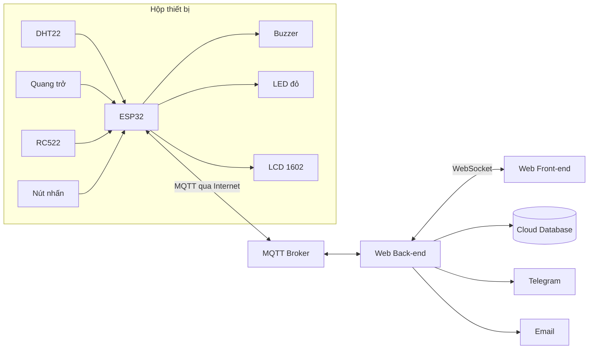

# Proposal đồ án cuối kỳ: Trạm học tập Pomodoro

**Môn học:** Vật lý cho Công nghệ thông tin (PHY00007), HK1/2026-2027  
**Lớp:** 25C07  
**Nhóm:** Nhóm 07  
**Giảng viên hướng dẫn:** Bùi Thanh Lâm, Cao Xuân Nam, Đặng Hoài Thương  
**Thành viên:**

| Vai trò | Họ tên | MSSV |
|---|---|---|
| Thành viên 1 (Môi trường và dữ liệu) | Trần Nguyễn Tuấn Minh | 24127084 |
| Thành viên 2 (Ánh sáng và phiên học) | Nguyễn Quốc Dương | 24127349 |
| Thành viên 3 (Web và hẹn giờ) | La Anh Hào | 24127361 |

**Hình thức:** Sản phẩm thật, đóng gói trong hộp.

---

## 1. Bối cảnh và vấn đề

Pomodoro là phương pháp học chia thời gian thành các phiên tập trung ngắn (thường 25 phút), xen kẽ các lần nghỉ ngắn (5 phút). Sau 4 phiên thì nghỉ dài hơn (15 đến 30 phút). Phương pháp này giúp giữ sự tập trung và tránh mệt mỏi khi học lâu.

Khi tự áp dụng Pomodoro, sinh viên thường gặp các vấn đề sau:

- Quên bấm giờ, hoặc dùng điện thoại để bấm giờ rồi bị cuốn vào mạng xã hội.
- Bỏ qua giờ nghỉ, học liên tục quá lâu nên mỏi mắt và giảm hiệu quả.
- Không biết mình đã học được bao nhiêu phiên, học vào giờ nào thì hiệu quả nhất.
- Không để ý góc học quá nóng, quá ẩm hoặc thiếu sáng.
- Người xung quanh (bạn cùng phòng, gia đình) không biết mình đang tập trung nên hay làm phiền.

## 2. Người dùng mục tiêu

- Sinh viên, học sinh tự học ở nhà hoặc phòng trọ.
- Người làm việc tại nhà muốn quản lý thời gian tập trung.

## 3. Giải pháp

**Trạm học tập Pomodoro** là một hộp nhỏ đặt trên bàn học, dùng ESP32 kết nối với website do nhóm tự xây dựng qua giao thức MQTT. Sản phẩm:

- Giúp người dùng học đúng nhịp Pomodoro mà không cần dùng điện thoại: đặt phiên trên web, hết giờ thì còi báo.
- Ghi lại các phiên học bằng cách quẹt thẻ RFID.
- Báo cho người xung quanh biết đang tập trung bằng đèn đỏ.
- Theo dõi nhiệt độ, độ ẩm, ánh sáng của góc học.
- Thống kê số phiên hoàn thành và phân tích điều kiện giúp học hiệu quả nhất.

## 4. Kịch bản sử dụng

1. Người dùng ngồi vào bàn, quẹt thẻ lên mặt hộp để bắt đầu phiên học.
2. Trên web, người dùng chọn thời lượng phiên (mặc định 25 phút). ESP32 bắt đầu đếm giờ.
3. Người dùng nhấn nút trên hộp, đèn đỏ sáng báo "đang tập trung".
4. Màn hình LCD hiển thị lời nhắc hoặc mục tiêu người dùng gõ trên web.
5. Hết phiên, còi kêu báo chuyển sang nghỉ.
6. Nếu người dùng học liên tục quá lâu mà không nghỉ, hệ thống gửi thông báo Telegram nhắc nghỉ.
7. Trong suốt quá trình, nhiệt độ, độ ẩm, ánh sáng được gửi lên web và lưu lại.
8. Cuối tuần, người dùng nhận email tổng kết số phiên Pomodoro đã hoàn thành.

## 5. Kiến trúc hệ thống

**Công nghệ dự kiến**

| Thành phần | Công nghệ |
|---|---|
| Vi điều khiển | ESP32 DevKit V1, Arduino framework |
| Giao thức | MQTT |
| Back-end | Node.js, Express, MQTT.js, Socket.IO |
| Front-end | React, TypeScript |
| Cơ sở dữ liệu (cloud) | MongoDB Atlas |
| Thông báo | Telegram Bot, Email (SMTP) |

Website do nhóm tự xây dựng, không dùng NodeRED.

## 6. Yêu cầu căn bản

Mỗi thành viên phụ trách một luồng, tự viết code ở cả ESP32, back-end và front-end.

| Thành viên | Loại luồng | Luồng xử lý |
|---|---|---|
| 1 | Input → Web | DHT22 → ESP32 → MQTT → Web BE → Web FE: hiển thị nhiệt độ, độ ẩm góc học |
| 2 | Input → Web | Quang trở → ESP32 → MQTT → Web BE → Web FE: báo ánh sáng có đủ để học không |
| 3 | Web → Output | Web FE → Web BE → MQTT → ESP32 → Buzzer: đặt thời lượng phiên Pomodoro, hết giờ còi báo nghỉ |

## 7. Yêu cầu nâng cao

| Thành viên | Yêu cầu | Mô tả | Điểm dự kiến |
|---|---|---|---|
| 1 | YC4 | Lưu dữ liệu cảm biến và phiên học theo thời gian lên cloud | 1.5 |
| 1 | YC5 | Hiển thị lịch sử dạng chart trên web | 1.5 |
| 1 | YC11 | Tự xây dựng mô hình phân tích điều kiện (giờ học, nhiệt độ, ánh sáng) giúp hoàn thành nhiều phiên Pomodoro nhất | 2.0 |
| 2 | YC1 | Nút nhấn → ESP32 → LED đỏ "đang tập trung" | 1.5 |
| 2 | YC2 | Quẹt thẻ RFID (RC522) → Web FE để bắt đầu, kết thúc phiên học | 1.5 |
| 2 | YC6 | Thông báo nhanh qua Telegram khi học quá lâu không nghỉ | 1.0 |
| 2 | YC7 | Email tổng kết số phiên Pomodoro mỗi tuần (làm nếu kịp) | 1.0 |
| 3 | YC3 | Web FE → ESP32 → LCD 1602 hiển thị lời nhắc, trạng thái phiên | 1.5 |
| 3 | YC9 | Đăng ký, đăng nhập, tài khoản lưu trong database | 1.5 |
| 3 | YC10 | Tự xây dựng website quản lý | 2.0 |

**Dự phòng:** YC8 (chatbot hỏi tình trạng hệ thống), YC12 (cấu hình WiFi bằng WiFiManager).

## 8. Thiết bị

Tất cả thiết bị giữa các yêu cầu đôi một khác nhau.

| Thiết bị | Dùng cho | Loại |
|---|---|---|
| DHT22 | Luồng căn bản, Thành viên 1 | Input |
| Module quang trở LM393 | Luồng căn bản, Thành viên 2 | Input |
| Buzzer chủ động | Luồng căn bản, Thành viên 3 | Output |
| Nút nhấn | YC1, Thành viên 2 | Input |
| LED đỏ | YC1, Thành viên 2 | Output |
| RFID RC522 | YC2, Thành viên 2 | Input |
| LCD 1602 I2C | YC3, Thành viên 3 | Output |

Linh kiện phụ: ESP32 DevKit V1, breadboard MB-102, dây cắm, board đục lỗ, header cái, adapter nguồn, module nguồn breadboard, jack DC, điện trở, hộp nhựa.

## 9. Sơ đồ nối chân

| Thiết bị | Chân thiết bị | Chân ESP32 |
|---|---|---|
| DHT22 | + / out / − | 3V3 / GPIO4 / GND |
| Quang trở LM393 | VCC / AO / GND | 3V3 / GPIO34 / GND |
| Buzzer (kích mức thấp) | VCC / I/O / GND | 3V3 / GPIO25 / GND |
| Nút nhấn | 2 chân chéo | GPIO27 (INPUT_PULLUP) / GND |
| LED đỏ | Anode qua điện trở 220 Ω / Cathode | GPIO26 / GND |
| LCD 1602 I2C | VCC / SDA / SCL / GND | 5V (VIN) / GPIO21 / GPIO22 / GND |
| RC522 | 3.3V / SDA(SS) / SCK / MOSI / MISO / RST / GND | 3V3 / GPIO5 / GPIO18 / GPIO23 / GPIO19 / GPIO17 / GND |

## 10. Danh sách topic MQTT

| Topic | Hướng | Dữ liệu (JSON) | Phụ trách |
|---|---|---|---|
| `study/dht` | ESP32 → Web | `{"temp": 29.5, "hum": 70}` | Thành viên 1 |
| `study/light` | ESP32 → Web | `{"raw": 2100, "level": "du_sang"}` | Thành viên 2 |
| `study/rfid` | ESP32 → Web | `{"uid": "A1B2C3D4", "action": "start"}` | Thành viên 2 |
| `study/timer` | Web → ESP32 | `{"minutes": 25}` | Thành viên 3 |
| `study/lcd` | Web → ESP32 | `{"text": "Hoc xong chuong 3"}` | Thành viên 3 |

## 11. Nguyên lý vật lý của các thiết bị

- **DHT22:** đo độ ẩm bằng tụ điện có điện dung thay đổi theo độ ẩm không khí; đo nhiệt độ bằng nhiệt điện trở. Dữ liệu được gửi về ESP32 qua một dây tín hiệu.
- **Quang trở:** vật liệu bán dẫn có điện trở giảm khi ánh sáng chiếu vào (hiện tượng quang dẫn). Mạch chia áp biến thay đổi điện trở thành thay đổi điện áp, ESP32 đọc bằng bộ chuyển đổi ADC.
- **RFID RC522:** đầu đọc phát từ trường xoay chiều tần số 13.56 MHz. Thẻ có cuộn dây nhận năng lượng nhờ cảm ứng điện từ và gửi mã định danh ngược lại.
- **Buzzer:** dòng điện làm màng rung (theo nguyên lý điện từ hoặc áp điện) tạo ra sóng âm.
- **LED:** khi có dòng điện qua lớp tiếp giáp p-n, electron và lỗ trống tái hợp và phát ra ánh sáng.
- **LCD 1602:** điện trường làm xoay các phân tử tinh thể lỏng, thay đổi khả năng cho ánh sáng phân cực đi qua để tạo ký tự.

## 12. Thiết kế hộp

- Kích thước dự kiến: khoảng 15 x 10 x 5 cm, hộp nhựa ABS.
- **Mặt trên:** LCD 1602, nút nhấn, LED đỏ, vùng in biểu tượng "quẹt thẻ" (RC522 dán ngay dưới, đọc xuyên lớp nhựa), lỗ nhỏ cho quang trở, lỗ thoát âm cho buzzer.
- **Mặt bên:** jack DC cấp nguồn, lỗ cổng USB để nạp code không cần mở hộp, khe thoáng cho DHT22.
- DHT22 đặt xa ESP32 để tránh nhiệt từ board làm sai số đo.
- [Chèn bản vẽ hộp tại đây]

## 13. Kế hoạch thực hiện

| Giai đoạn | Công việc |
|---|---|
| 1 | Mua linh kiện, thử từng linh kiện riêng lẻ, dựng repo Git, broker MQTT, khung web |
| 2 | Mỗi thành viên hoàn thành luồng căn bản chạy được trên breadboard |
| 3 | Thực hiện các yêu cầu nâng cao |
| 4 | Hàn mạch lên board đục lỗ, đóng hộp, kiểm thử toàn hệ thống |
| 5 | Viết báo cáo, tập vấn đáp chéo giữa các thành viên |

Toàn bộ mã nguồn được tích hợp trong một repo chung. Mỗi luồng nằm trong file riêng ở ESP32, back-end và front-end để thể hiện rõ phần việc của từng thành viên.

## 14. Rủi ro và giới hạn

- **Mất kết nối WiFi:** ESP32 tự kết nối lại; còi hẹn giờ vẫn hoạt động vì việc đếm giờ chạy trên ESP32.
- **WiFi trường có trang đăng nhập:** khi demo dùng WiFi phát từ điện thoại (2.4 GHz).
- **Sai số cảm biến:** DHT22 có sai số nhỏ và cần cách nhau ít nhất 2 giây giữa các lần đọc; quang trở chỉ cho mức sáng tương đối, không phải đơn vị lux chính xác.
- **Giới hạn sản phẩm:** đây là bản mẫu phục vụ học tập, chưa tối ưu về điện năng và độ bền.
